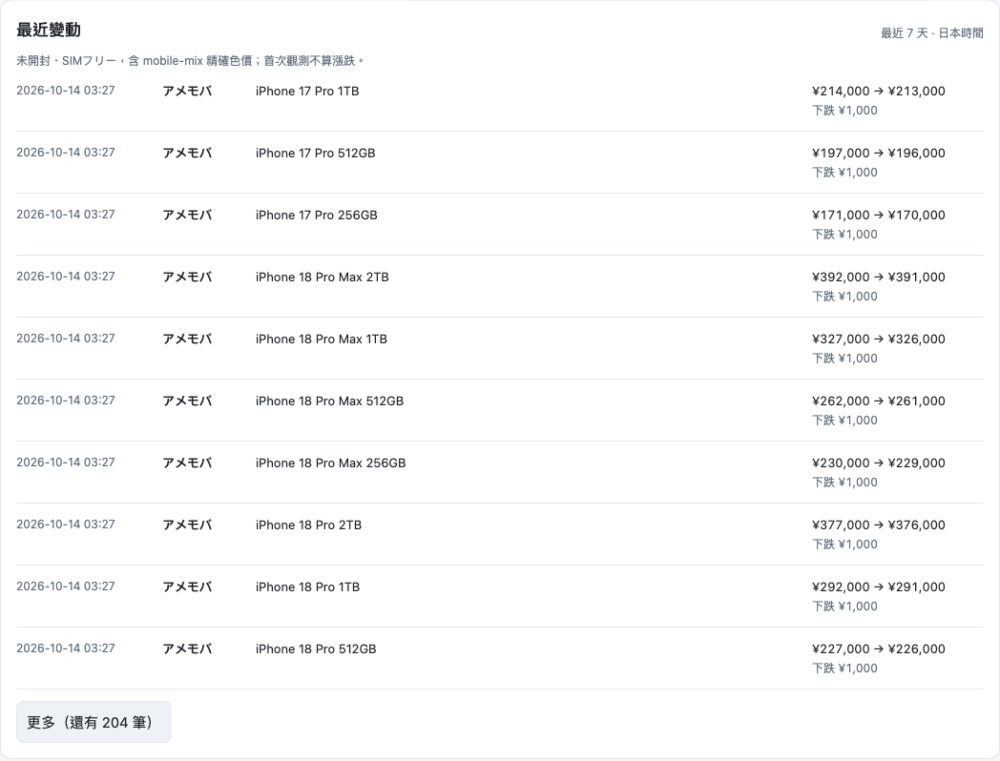
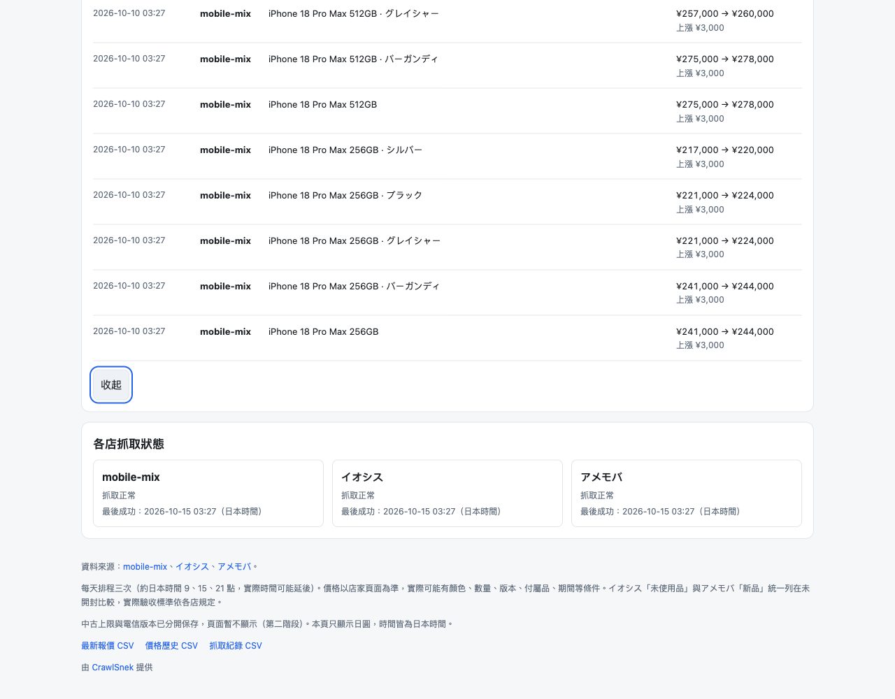
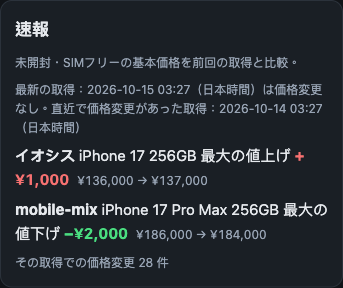
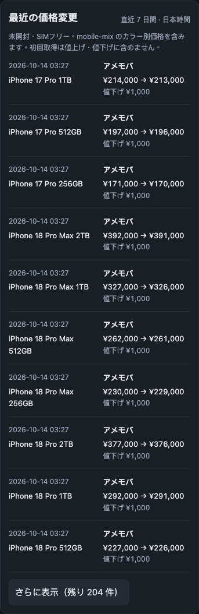
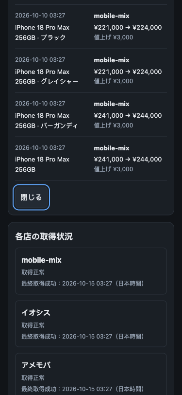

# 日本買取頁速報、最近變動與排程驗收（2026-10-15）

所有截圖與筆數均來自 `tests/jp_preview.py` 的 **fixture 示意資料**，不是店家當日真實價格。驗收只開本機 HTTP 預覽，外部請求（包含 GA）均封鎖。

## 修改行為

- 最新成功抓取有有效主價改價時，速報的原有文字與計算維持不變。
- 最新成功抓取沒改價時，以最新成功時間為終點回溯 7 天，取最近一次有可計主價改價的成功抓取。沿用 `recentChanges` 的過濾，排除首次觀測、色價、異常價、非未開封／SIMフリー主價及沒有成功紀錄的批次。
- `flash` 回傳 `latest_at` 與實際採用的 `at`；中日文同時顯示兩個時間，回溯筆數改用「該次」／「その取得」。7 天內沒有可計改價時，保留原有無改價文字。
- 最近變動依原排序與篩選顯示，預設 10 筆；超過 10 筆可展開全部或收起。原生 button 帶 `aria-expanded`、`aria-controls`，重繪後保留焦點。
- cron 改為 `17 0,6,12 * * *`，約日本 09:17／15:17／21:17；兩頁頁尾、description 與 AGENTS.md 同步說明排程及可能延遲。

## 離線測試

與 CI 相同的主版本：Python 3.12.14、Node 22.23.3。

| 檢查 | 結果 |
| --- | --- |
| `python -m unittest` | 158 項，全過 |
| `node --test tests/*.test.cjs` | 57 項，全過 |
| `git diff --check` | 通過 |

新增測試包含：回溯中日文兩個時間與漲跌／筆數、最新本身有改價不顯示回溯文字、7 天內無改價、7 天邊界與超過一毫秒、跳過無成功紀錄／色價／首次觀測／異常價／非主價，以及 25 筆收合 10 筆／剩 15 筆、展開全部、10 筆以內不顯示按鈕。

## 瀏覽器驗收

使用獨立無頭 Microsoft Edge，桌機中文淺色 1280×1000、手機日文深色 375×812；已逐張檢視截圖。機器驗收結果見 [verification.json](jp-flash-recent-validation/verification.json)。

- fixture 最新成功：日本時間 **2026-10-15 03:27**，沒有改價。
- 速報採用前一次：日本時間 **2026-10-14 03:27**，28 筆主價改價，同時有提價與砍價。
- 最近變動 214 筆（含色價），預設 10 筆，按鈕顯示剩 204 筆；Enter 展開 214 筆，Space 收回 10 筆，兩次都保留按鈕焦點並更新 `aria-expanded`。
- 兩個尺寸在收合、展開與再次收合時，`document.documentElement.scrollWidth` 均等於視窗寬度；無橫向捲動、無 JavaScript page error。按鈕沿用主題色並有可見鍵盤焦點。
- 展開截圖拍清單末端，呈現原本收合時看不到的舊紀錄及「收起／閉じる」；全部 214 筆由 DOM 計數確認。

### 桌機中文淺色






### 375px 手機日文深色







## 重現預覽

以下命令在 repo 根目錄執行，`--data` 必須使用不存在的新暫存路徑；fixture 程式會拒絕專案 `data/` 或混入既有示意資料的目錄。

```sh
python tests/jp_preview.py --data /tmp/jp-flash-preview-data
python site/build_site.py --data /tmp/jp-flash-preview-data --out /tmp/jp-flash-preview-site
python -m http.server 18765 --bind 127.0.0.1 --directory /tmp/jp-flash-preview-site
```

開啟 `http://127.0.0.1:18765/jp/` 與 `http://127.0.0.1:18765/jp/ja/`。重跑時使用另一個全新暫存目錄；時間依執行當下的日本時間，價格是示意數字。

## 範圍與限制

程式變更限 `.github/workflows/jp.yml`、`AGENTS.md`、`site/jp/{index.html,ja/index.html,jp.js,jp.css}`、`tests/{jp.test.cjs,jp_preview.py}`；另附本驗收紀錄、JSON 與六張 fixture 截圖。

提交清單已檢查，沒有任何 `data/` 檔案；`tracker.py`、`jp/buyback.py`、`site/jp_build.py`、建置流程及 `track.yml`、`column.yml`、`pages.yml` 未修改。比較表、走勢圖與台灣頁行為未修改。

GitHub schedule 在整點負載較高時可能延遲，負載過高甚至可能丟棄排隊工作；避開整點只能降低風險，不能保證準時或保證每天實跑三次，實際時間以 `runs.csv` 為準。參考 [GitHub 官方 schedule 文件](https://docs.github.com/en/actions/reference/workflows-and-actions/events-that-trigger-workflows#schedule)。沒有新增延遲跳過判斷。

本次交付停在 PR，待 Claude 覆核；未合併、未推 main、未部署。
